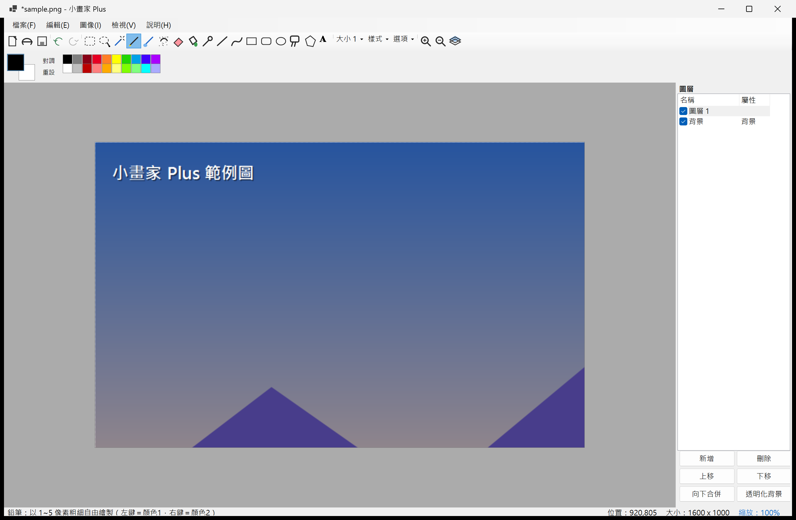
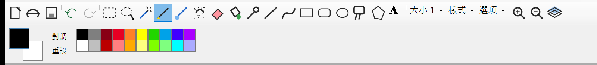
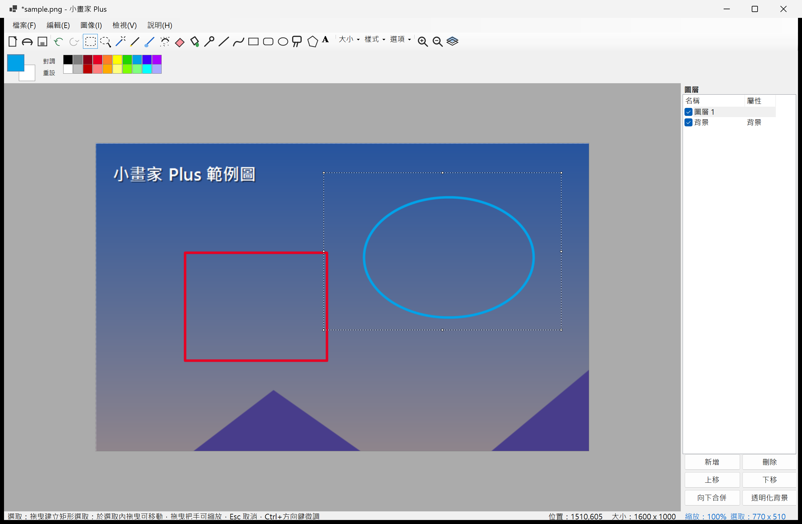
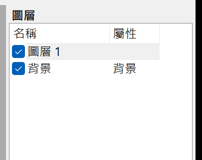

# 小畫家 Plus（PaintClone）

以 **.NET 10（WinForms）** 重建的 Windows 小畫家。功能清單並非憑記憶，而是以 REA（Ghidra）對裝機原件
`Microsoft.Paint 11.2605.81.0` 的 `BasePaint.dll`／`PaintUI.dll` 進行靜態逆向研究取得，
完整證據見 [`docs/PAINT_FEATURES.md`](docs/PAINT_FEATURES.md)。

## 系統截圖

以下都是本專案**實際執行的畫面**（Windows 11 x64／.NET 10 Desktop／200% DPI 縮放，原始解析度擷取，非設計稿）。

### 主視窗



由上而下分別是選單列（檔案／編輯／圖像／檢視／說明）、工具列、雙色彩＋調色盤列；中央是畫布，
右側為圖層面板，最底部狀態列即時顯示「工具提示｜滑鼠座標｜圖片尺寸｜縮放比率」。
圖中開啟了一張 1600×1000 的範例圖，縮放 100%，圖層面板有「圖層 1」與「背景」兩層。

### 工具列與調色盤



左起為檔案與復原群組，接著是 17 種工具：選取、任選、魔法棒、鉛筆、筆刷、噴槍、橡皮擦、填色、取色、
直線、曲線、矩形、圓角矩形、橢圓、標註框、多邊形、文字；其後是「大小」（筆劃粗細）、「樣式」
（只有外框／僅填色／外框＋填色）、「選項」（填色容差、魔法棒容差、圓角半徑、標註框邊寬、文字字型…）
與縮放、圖層面板開關。下方左側是顏色 1／顏色 2 色塊與「對調／重設」，右側為 20 色調色盤（左鍵設顏色 1、右鍵設顏色 2）。

### 圖形工具


「矩形」與「橢圓」繪製中會即時預覽，放開滑鼠即完成；此例樣式＝只有外框、大小＝8 像素，
顏色 1 為紅、藍。圓角半徑與標註框邊寬可在「選項」調整，繪製矩形／橢圓時按住 `Shift` 可鎖正方形／正圓。

### 矩形選取



選取工具拖曳後出現螞蟻線外框與 8 個把手：框內拖曳移動內容、把手拖曳縮放內容、`Del` 刪除（填入顏色 2，
非背景層擦成透明）、`Ctrl+方向鍵` 微調 1px（`Shift` 為 10px）、`Esc` 取消。狀態列右側同時顯示選取範圍尺寸。

### 圖層面板



每層一個能見度核取框＋名稱／屬性欄位；下方按鈕為新增、刪除、上移、下移、向下合併、透明化背景。
面板可直接拖曳項目重新排序（反白提示落點），拖曳左緣分割尺可調整寬度。

## 執行

```powershell
git clone https://github.com/jimmy0206/PaintClone.git
cd PaintClone
dotnet run
```

或編譯後執行 `bin\Debug\net10.0-windows\PaintClone.exe`（需 Windows + .NET 10 Desktop Runtime）。
`dotnet run -- <圖片路徑>` 可直接開啟圖片，也支援把檔案拖放進視窗。

## 功能對照（皆已實作）

### 繪圖工具（17 種，對應原版 Operation 符號）
| 工具 | 對應原版符號 |
|---|---|
| 鉛筆（1–5px、逐像素硬邊） | `CDrawStrokeOperation` |
| 筆刷（反鋸齒圓頭筆劃） | `CapsuleStrokeOperation` |
| 噴槍（按住連噴） | `DrawAirBrushOperation` |
| 橡皮擦（粗細可調、圓/平頭） | `EraserOperation` |
| 填色（容差可調） | `FloodFillOperation` |
| 取色（左/右鍵設顏色1/2） | 色 picker |
| 魔法棒（容差選取，取代 AI Magic Select） | `ObjectSelectOperation` 的替代 |
| 直線（Shift 鎖 15°） | `CDrawLineOperation` |
| 曲線（三點貝茲爾） | `CDrawBezierOperation` |
| 矩形／圓角矩形／橢圓／標註框 | `ShapeFactory::CreateRectangle/Ellipse/RoundedRectangle/RoundedRectangularCallout` |
| 多邊形（右鍵/雙擊閉合） | `CDrawPolygonOperation` |
| 文字（畫布內編輯、可透明底） | `TextToolOperation` |
| 選取（矩形＋移動＋8 縮放把手） | `SelectionOperation` + `ModifiableToolOperation` |
| 任選（套索） | `MaskBasedSelectionOperation` |

### 圖像選單
調整大小（像素/百分比、維持長寬比、有選取時只縮選取）、傾斜（H/V）、
旋轉 90/180/任意角度、水平/垂直反轉、裁剪、反相、灰階、褐色調、調整顏色（色相/飽和/亮度/對比＋即時預覽）、圖像資訊。

### 檔案
新增／開啟／儲存／另存（PNG、JPEG、BMP、GIF、TIFF）、列印、設為桌面佈景主題、最近使用的檔案、拖放開啟、
剪下／複製／貼上／刪除、全選／取消選取。存檔格式與 JPEG 品質與原版一致。

### 其他
雙色彩模型＋調色盤＋自訂色、工具提示列、狀態列（座標/尺寸/縮放）、縮放 1%–3200%、網格線、鍵盤捷徑（Ctrl+N/O/S/Z/Y/X/C/V/A/E/P、Del、X 對調顏色、Ctrl±縮放…）。

## 相對原版的優化

1. **復原 100 步**（原版 3～10 步），且以髒矩形快照大幅省記憶體
2. **填色容差可調**（原版只能精確匹配）
3. **圖層**：新增/刪除/排序/可見度/向下合併／貼上成新圖層（對應新版 Paint 圖層功能）
4. **自動存檔崩潰回覆**（每 20 秒，重啟提示復原）
5. **透明顯示 checkerboard**（舊版以洋紅代表透明）；非背景層橡皮擦擦為**透明**而非背景色
6. **Ctrl+滾輪以滑鼠為錨點縮放**、中鍵拖曳平移
7. **魔法棒**容差選取（取代需要 ONNX 模型的 AI Magic Select）
8. 繪製中shapes **即時預覽**、多邊形頂點可視化
9. 高 DPI（PerMonitorV2）、ANYCPU x64、System.Drawing 原生 SIMD 像素操作
10. 貼上直接生成新圖層，避免原版浮動選取的編輯阻塞

## 滑鼠／介面 UX 優化（第二輪改進）

- **邊緣自動捲動**：拖曳繪圖/選取到視埠邊緣時自動平移畫面，高縮放不再畫不出去
- **滑鼠擷取**：在畫布外放開滑鼠也能正常結尾，工具不會卡在拖曳狀態
- **Space＋左鍵拖曳＝平移**（沒有中鍵也能拖畫面；中鍵平移保留）
- **游標即見即所得**：筆刷/橡皮擦/噴槍顯示依粗細×縮放的圓形輪標；選取工具在把手上顯示方向箭頭、選取內顯示移動游標
- **拖曳即時尺寸**：框選/縮放顯示「W × H」、直線顯示長度、移動顯示座標（游標旁小标签）
- **選取體驗**：移動後選取跟隨內容（原版會消失）；8 個可見縮放把手；拖曳中按 Esc 取消移動；2px 拖曳閾值防誤觸
- **Ctrl+方向鍵**微調選取內容 1px（＋Shift 為 10px）
- **套索閉合參考線**：畫圈時顯示最後點→起點的灰色虛線
- **目前工具高亮**＋「大小」按鈕直接顯示目前粗細
- **圖層面板**：拖曳項目即可重新排序（反白提示落點）、可拖曳左緣改變寬度
- **狀態列縮放比率可點擊**，直接選 10%–800%／適宜／傳真大小
- 修正：魔法棒遮罩在非原點選取時的 Contains 判斷

## 高 DPI 排版修正（第三輪改進）

使用者於高解析度／縮放螢幕回報元件跑版，根源與修正：

- **表單啟用 DPI 縮放**：`AutoScaleMode.Dpi`＋`AutoScaleDimensions=96`，全部控制項尺寸隨裝置 DPI 遞迴縮放（先前只有字型放大、像素常數不變 → 文字壓色票、按鈕截半）
- **工具列圖示原生解析度重繪**：圖示依 DPI 以 IconFactory 重新產生（不失真）；佈局改 Flow，寬度不足自動換行，不再出現溢出箭頭
- **狀態列改一般 Panel＋Label**：StatusStrip 的 Spring/Table 佈局會把「縮放」標籤推出可見區；現在 提示(自動截斷)／位置／大小／縮放 永遠可見
- **調色盤自繪座標依 DeviceDpi 縮放**；「對調/重設」文字改置中於按鈕框內；面板高度修正（原 44 會截掉 color2 色塊底緣）
- **圖層面板**：按鈕改手動 2 欄×3 列依 DPI 排列（原固定 64px 高截半）；欄寬依 DPI 調整；分割尺上下限依 DPI 換算
- **視窗尺寸**以實體像素存/取並在載入時收斂到工作區，避免跨 DPI 會話越開越大
- **文字工具編輯框隨縮放重算尺寸**（修正「放大後殘留巨大白色區域」）；捲軸鋪滿邊角，右下角不再露白

## 即時繪製與縮放視窗修正（第四輪改進）

- **拖曳即時繪製**：畫布 `OnPaint` 改逐層直接合成，不再走 `Compose()` 快取。舊實作中筆刷／鉛筆／橡皮擦／噴槍／填色直接寫圖層位圖但不失效快取，導致「放開滑鼠才看到線條」；現在每一筆移動都立刻反映（並只重繪筆劃涵蓋的局部範圍，拖曳更順）
- **拖曳調整視窗大小不再殘留**：畫布尺寸變動時整幅重繪（捲軸隱現不留殘影）；表單啟用雙緩衝，dock 重排過程整幅離屏合成；繪圖內容即時正確，縮放視窗不會再刷出舊像素

## 刻意不重建（需 ML／雲端服務）

AI 產生式填色（`GenerativeFillOperation` + `mager.onnxe`）、AI 物件選取分割（`seg.onnxe`）、
多人協作、故事板 —— 證據顯示依賴 `AIServices.dll` 與本機 ONNX 模型，超出離線重建範圍。

## 鍵盤與滑鼠操作

| 操作 | 鍵位 |
|---|---|
| 新增／開啟／儲存／另存新檔／列印 | `Ctrl+N`、`Ctrl+O`、`Ctrl+S`、`Ctrl+Shift+S`、`Ctrl+P` |
| 復原／重做（最多 100 步） | `Ctrl+Z`、`Ctrl+Y` |
| 剪下／複製／貼上（貼上成新圖層） | `Ctrl+X`、`Ctrl+C`（無選取時複製整張圖）、`Ctrl+V` |
| 全選／取消選取／刪除選取（填入顏色 2） | `Ctrl+A`、`Ctrl+E`、`Del` |
| 微調選取內容 | `Ctrl+方向鍵` 1px、`Ctrl+Shift+方向鍵` 10px |
| 放大／縮小／傳真大小（100%） | `Ctrl++`、`Ctrl+-`、`Ctrl+0` |
| 以滑鼠位置為錨點縮放 | `Ctrl`＋滾輪 |
| 捲動／水平捲動 | 滾輪、`Shift`＋滾輪 |
| 平移畫布 | 中鍵拖曳，或 `Space`＋左鍵拖曳 |
| 對調顏色 1／顏色 2 | `X` |
| 主要／次要顏色繪製 | 滑鼠左鍵＝顏色 1、右鍵＝顏色 2（取色、填色、筆劃皆適用） |
| 鎖正方形／正圓／15° 直線 | 拖曳時按住 `Shift` |
| 結束多邊形 | 右鍵或雙擊 |
| 取消選取／取消進行中的操作 | `Esc` |

## 專案結構

```
PaintClone/
├── PaintClone.csproj        # net10.0-windows / WinForms
├── Program.cs               # 進入點（DPI、命令列開啟檔案）
├── Core/
│   ├── Settings.cs          # 設定持久化（%APPDATA%\PaintClone）
│   ├── ImageOps.cs          # 泛洪填充/魔法棒/變換/濾鏡（unsafe 像素操作）
│   └── SelectionOps.cs      # 剪貼/裁剪/選取內變換/效果
├── Document/
│   ├── PaintDocument.cs     # 圖層堆疊 + 100 步 undo/redo（swap 式快照）
│   └── SelectionManager.cs  # 矩形/套索/遮罩選取 + Region + 邊界快取
├── Rendering/CanvasControl.cs  # 視埠縮放捲動、螞蟻線、網格、工具路由
├── Tools/                   # 17 個工具實作（筆劃/形狀/文字/選取）
├── UI/                      # 主窗體、調色盤、圖示產生器、對話框
└── docs/                    # PAINT_FEATURES.md（逆向研究報告）、images/（README 截圖）
```

## 測試

核心邏輯（泛洪填充、選取、undo/redo、PNG 透明往返、圖層合成…）另有 14 項冒煙測試，結果 **14/14 通過**；
該測試專案為開發期工具，未一併放在本倉庫中。

建置品質：`dotnet build -c Release` → **0 警告／0 錯誤**。
